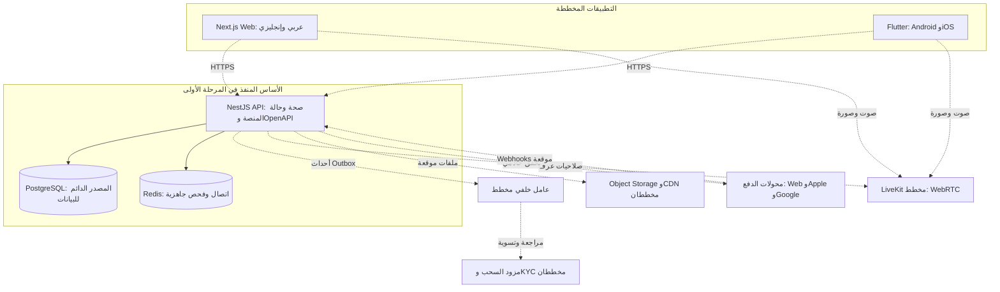

# معمارية LiveStar

## نطاق المرحلة الأولى

نبدأ بخادم واحد مقسم إلى وحدات واضحة داخل Monorepo. هذا يقلل تعقيد التشغيل
ويتيح تنفيذ المعاملات المالية في قاعدة PostgreSQL واحدة. فصل وحدات داخل
الكود لا يعني إنشاء خدمات مستقلة لكل وحدة الآن. يمكن فصل العمل الخلفي
والوسائط عند ظهور أحمال تقاس فعليًا.

المنفذ الآن: خادم NestJS بفحوص صحة حقيقية، عقد OpenAPI، مخطط Prisma،
ترحيلات SQL، إعدادات مرجعية، حسابات أعداد صحيحة، واختبارات.
بقية الأسهم المتقطعة في الرسم مكونات مخططة لم تُربط بعد:

تشغيل حاوية LiveKit أو MinIO الاختيارية لا يكمل ربطها بالتطبيق.
Redis في هذا الإصدار اعتماد يتم فحصه؛ لم يُنفّذ بعد ناقل WebSocket أو طابور وظائف.

## حدود الوحدات المستهدفة

| الوحدة | المسؤولية | المرحلة الأساسية |
| --- | --- | --- |
| Identity | مستخدمون وجلسات وتدوير refresh tokens وصلاحيات RBAC | 2 |
| Social | ملفات شخصية ومتابعة وحظر وبحث وإشعارات | 2–3 |
| Streaming | دورة الغرفة وصلاحيات LiveKit والمشاهدون وجودة الاتصال | 4 |
| Messaging | محادثة البث ورسائل وصلاحيات الكتم والإبلاغ | 4 |
| Catalog / Coins | الهدايا وأسعارها وحزم العملات ومحافظ الاستهلاك | 5 |
| Payments | محولات المزودين وإيصالات الشراء والتحقق من Webhooks | 6 |
| Accounting | إسناد صافي الإيراد والقيود والتسويات والاستردادات والنزاعات | 5–7 |
| Payouts | أهلية السحب وKYC والبلدان والحسابات المدعومة | 7 |
| Moderation / Admin | مراجعة المحتوى والمخالفات ولوحات الإدارة والتدقيق | 4 و7 |

هذه حدود تصميم؛ لا تمثل endpoints تجارية جاهزة. كل API معلن حاليًا موثق
في `/api/openapi.json`، ولا توجد عمليات شراء أو سحب أو مصادقة مخفية.

## حدود الثقة

العميل جهاز غير موثوق. أسعار الهدايا وملكية الغرف وصلاحيات المستخدم ورصيد
المحفظة يجب التحقق منها خادميًا. لا يُقبل إشعار نجاح دفع من المتصفح دليلًا
لشحن الرصيد؛ المرحلة السادسة ستربط إيصال المزود أو webhook الموقّع مع
الطلب ومعرف الحدث الفريد قبل أي قيد.

قاعدة البيانات مصدر الحقيقة المالية. Redis سيستخدم للتواجد والحدود الزمنية
والتوزيع اللحظي، ولن يكون بديلًا عن أرصدة PostgreSQL. فشل إرسال حدث خارجي
بعد الالتزام يعالج لاحقًا بعامل Outbox مع إعادة محاولة آمنة؛ وجود جدول
`outbox_events` الآن لا يعني تنفيذ العامل.

فصل صلاحيات الاتصال يبدأ من البنية التحتية: `livestar_owner` مالك الترحيلات،
و`livestar_app` هو اتصال الخادم المحدود. لا يمرر Compose سر مالك الترحيلات إلى
حاوية API. في الإنتاج يجب أن تكون إدارة الترحيلات منفصلة عن دورة تشغيل الطلبات،
وألا تُخزّن بيانات KYC الخام في سجلات التطبيق أو جداول الإشعارات.

خادم الوسائط ينقل الصوت والصورة؛ API يصدر لاحقًا رموز غرف قصيرة العمر بعد
فحص الصلاحية. لا يعتمد منح صلاحية النشر على اسم غرفة يرسله العميل.
توسعة البث إلى جماهير كبيرة تحتاج قياس سعة SFU وخطة TURN وتوزيع إقليمي
وخيارات بث مشاهدة واسعة، وليست مضمونة بمجرد استخدام WebRTC.

## مجموعات البيانات

التعريف الكامل ومفاتيح العلاقات في
[`schema.prisma`](../packages/database/prisma/schema.prisma).

| المجال | الجداول |
| --- | --- |
| الهوية والعلاقات | `users`, `user_profiles`, `roles`, `user_roles`, `sessions`, `follows`, `user_blocks` |
| البث والمحادثة | `live_streams`, `stream_viewers`, `live_messages`, `stream_mutes` |
| الكتالوج والعملات | `gifts`, `coin_packages`, `coin_wallets`, `coin_lots`, `gift_transactions`, `gift_allocations` |
| دفتر الحسابات | `ledger_accounts`, `ledger_journals`, `wallet_ledger`, `revenue_splits`, `creator_earnings` |
| المدفوعات والسحب | `payment_orders`, `payment_webhooks`, `payout_requests`, `payout_accounts`, `identity_verifications`, `refunds`, `disputes` |
| التشغيل والحوكمة | `notifications`, `reports`, `moderation_actions`, `admin_audit_logs`, `platform_settings`, `outbox_events` |

المبالغ الأصلية تحفظ بعملتها ودقتها الأصلية، والعملة المحاسبية المرجعية USD.
دفتر العملات ودفتر USD بوحدتين منفصلتين؛ لا يوجد سعر صرف عام يحول الرصيد
المشتَرى إلى مبلغ قابل للسحب. مرجع التقريب وإسناد صافي الإيراد والقيود في
[السياسة المحاسبية](ACCOUNTING.md).

المخطط يستخدم مفاتيح أجنبية وفهارس وقيمًا مالية دقيقة. العلاقات الحساسة
للأموال مقيدة الحذف، وتاريخ السياسات يحفظ للمعاملات اللاحقة. هذه البنية لا
تنفّذ وحدها التسويات أو رد الأموال أو الامتثال؛ يلزم تطبيق تدفقات الأعمال
والتحقق منها في مراحلها.

## معايير التطوير

العربية والإنجليزية مع RTL وLTR من تصميم المرحلة الثالثة، مع فصل نصوص الواجهة
عن البيانات والأسعار المحلية. الزمن التشغيلي UTC، وتواريخ الإيصالات والسياسات
تحفظ بدقة مع المنطقة الزمنية. لا تُخزن مفاتيح المزود أو الأسرار في المستودع.
كل مرحلة تنتج ترحيلات متتابعة واختبارات ومعيار قبول واضح قبل المرحلة التالية.
